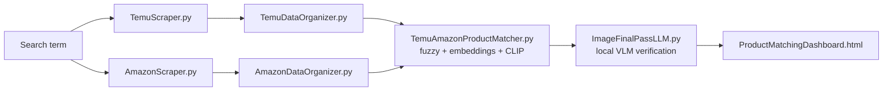

# RetailScan: Temu ↔ Amazon Product Matcher

> **Status: archived (June–August 2025).** This was a personal project and I'm no longer working on it. The core pipeline works end to end; some newer dashboard features are unfinished (see [Known issues](#known-issues)).

RetailScan scrapes the same search term on **Temu** and **Amazon**, works out which listings are the *same physical product*, and shows the price gap between the two. It's meant to answer the question a reseller would ask: *"Is this cheap Temu item sold on Amazon for a lot more?"*

Matching uses three signals together (fuzzy title matching, sentence embeddings, and CLIP image embeddings). A **local vision-language model** then looks at both product photos and makes the final same-or-different call.

<!-- TODO: add a screenshot or GIF here. This is the most important part of the README. -->
<!--  -->

---

## Features

- **Two scrapers running in parallel.** Playwright with persistent browser profiles scrapes Temu and Amazon for any search term and saves a shared CSV schema plus product images.
- **Hybrid product matching**
  - Fuzzy title similarity ([RapidFuzz](https://github.com/rapidfuzz/RapidFuzz))
  - Semantic title similarity ([`all-MiniLM-L6-v2`](https://huggingface.co/sentence-transformers/all-MiniLM-L6-v2) sentence embeddings)
  - Visual similarity ([OpenAI CLIP](https://github.com/openai/CLIP) `ViT-B/32`)
  - Weighted score: 25% fuzzy, 35% text embedding, 40% image. Without images it falls back to 40% fuzzy and 60% text embedding.
- **LLM verification.** The top candidates go to a local vision-language model through [LM Studio](https://lmstudio.ai/). The model sees both images, both titles and the price difference, and returns structured JSON (`same_product`, `image_similarity`, `rationale`).
- **Incremental runs.** A persistent embedding cache and a comparison history mean that re-running a search only compares new items.
- **Single-item search.** Upload a photo and title of any product to find its closest matches in everything you've already scraped, then re-rank them with the LLM.
- **Resale viability screener.** An LLM scores products on quality, demand, competition and safety risk using a strict JSON schema.
- **Web dashboards**
  - *Pipeline Dashboard*: start and stop the pipeline from the browser and watch a live log stream (Server-Sent Events).
  - *Product Matching Dashboard*: browse matched pairs side by side, filter by confidence, export results.
  - *Product Search / Single Item Results*: the single-item matching flow.

## How it works



`MasterPipeline.py` runs every step in order. `PipelineServer.py` wraps it in a Flask API so the whole thing can be driven from the browser.

| Step | Script | Output |
|---|---|---|
| Scrape | `TemuScraper.py`, `AmazonScraper.py` | `{platform}_{category}.csv` + `{platform}_{category}_imgs/` |
| Organize | `TemuDataOrganizer.py`, `AmazonDataOrganizer.py` | `{platform}_{category}_analysis.json` |
| Match | `TemuAmazonProductMatcher.py` | `matching_results_{category}.json` |
| Verify | `ImageFinalPassLLM.py` | `matching_results_llm_{category}.json` |
| View | `ProductMatchingDashboard.html` | — |

## Tech stack

**Python:** Playwright, Flask, PyTorch, sentence-transformers, OpenAI CLIP, RapidFuzz, NumPy, Pillow
**LLM:** LM Studio (OpenAI-compatible local server) running a vision-language model
**Frontend:** Vanilla HTML/CSS/JS dashboards (there's also an early React + Vite prototype in `dashboard/` that I abandoned)

## Running it

> Developed and tested on Windows with Python 3.11. You need a GPU for reasonable CLIP and LLM speeds.

```bash
pip install -r requirements.txt
pip install git+https://github.com/openai/CLIP.git
playwright install chromium
```

1. Start **LM Studio**, load a vision-capable model, and start its local server (default `http://localhost:1234`).
2. Run the full pipeline from the command line:

   ```bash
   python MasterPipeline.py --search "baby toys" --http-server
   ```

   Useful flags: `--skip-scraping` (reuse existing CSVs), `--skip-llm`, `--step {scrape|organize|match|llm|dashboard|serve}`, `--clear-history`.

3. **Or** use the web UI:

   ```bash
   python PipelineServer.py            # pipeline dashboard → http://localhost:5001
   python SingleItemFlaskBackend.py    # single-item search → http://localhost:5000
   ```

The first time a scraper runs, it opens a visible browser window. You may have to clear a captcha or log in by hand once. After that, the session is saved in a local browser profile.

## Known issues

- Passing an item from the Product Matching Dashboard to the single-item search with "Find similar" fails with a JSON parse error (`<!DOCTYPE ... is not valid JSON`). The request seems to get an HTML page back instead of JSON.
- The single-item matcher doesn't yet use the full `MasterPipeline` flow.
- Both scrapers depend on Temu's and Amazon's current page layouts, so they will break when those sites change.

## What I learned

<!-- Write this section in your own voice. Recruiters and other developers read it most closely. Some prompts: -->
- Getting past bot detection on modern e-commerce sites (persistent profiles, human-like scrolling, rate limiting)
- Combining cheap signals (fuzzy matching) with expensive ones (CLIP, a VLM) so the expensive ones only run on likely candidates
- Caching embeddings and tracking comparison history so re-runs only cost as much as the new items
- Getting structured JSON output from local LLMs reliably
- Browser CORS and `file://` limitations, and why the dashboards ended up served over HTTP

## Why I stopped / what I'd do next

<!-- Be honest and brief. For example: "I got the pipeline working end to end and learned what I set out to learn." Then list what you'd change: -->
- Replace the CSV/JSON files with a real database (SQLite/Postgres)
- Package everything as one app instead of separate scripts linked by wrapper files
- Add proper tests and a `requirements.txt` lockfile

## Disclaimer

This project was built for educational purposes. Scraping may violate the Terms of Service of the sites involved. No scraped data is distributed with this repository.
